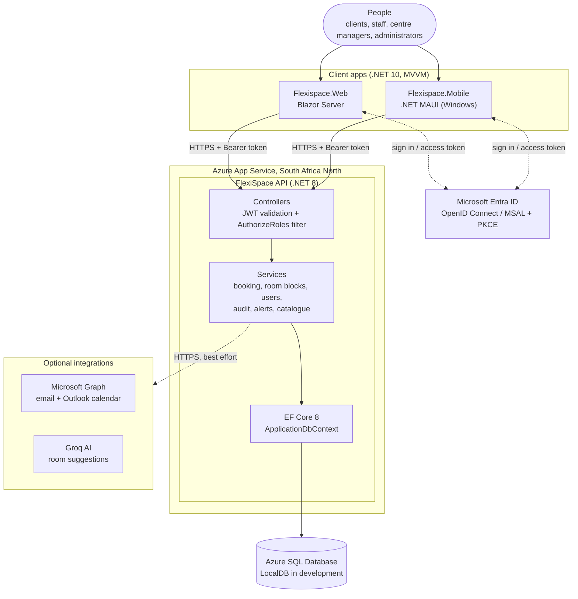

# FlexiSpace Multi-Boardroom Booking System

**INSY7315 Work Integrated Learning 2026, final project. Built by FlexiTech Managed IT Services.**

FlexiSpace runs serviced offices at three centres: **Centurion**, **Houghton Estate** and **Eagle Canyon**. Before this system, each centre manager kept bookings in a separate Outlook calendar. Nobody could see every room at once, and the same room could be booked twice.

This repository replaces those calendars with **one booking engine and two apps**:

- **FlexiSpace API**: ASP.NET Core (.NET 8). It holds every booking rule, role check and audit record.
- **Flexispace.Web**: a Blazor Server website (.NET 10).
- **Flexispace.Mobile**: a .NET MAUI app (.NET 10, Windows).

Everyone signs in with their **Microsoft Entra ID** (Microsoft 365) account. Entra proves who the person is. The FlexiSpace `Users` table decides their role and centre.

| | |
|---|---|
| Demo video | [FlexiSpace walkthrough (YouTube)](https://youtu.be/u7t71c99ZCk) |
| Hosted API (Azure App Service, South Africa North) |https://flexispace-exdye9dzg3bhejh9.southafricanorth-01.azurewebsites.net/ |
| Team repository | https://github.com/EMGPRS/insy7315-2026-insy7315-2026-final-project-maluleke-khensani.git |

---

## Table of contents

1. [Features](#features)
   - [Roles](#roles)
2. [Architecture](#architecture)
3. [Repository layout](#repository-layout)
4. [Prerequisites](#prerequisites)
5. [Quick start: run the apps against the hosted API](#quick-start-run-the-apps-against-the-hosted-api)
6. [Run the full stack locally](#run-the-full-stack-locally)
7. [Configuration and secrets](#configuration-and-secrets)
8. [Tests and CI](#tests-and-ci)
9. [Deployment](#deployment)
10. [More documentation](#more-documentation)
11. [Team: FlexiTech Managed IT Services](#team-flexitech-managed-it-services)

---

## Features

**Booking**
- Four-step booking: location → room → date and time → details (attendees, company, equipment, catering, notes).
- Times that are already booked are greyed out. The API also rejects any overlap with a confirmed booking or a blocked period.
- Bookings are confirmed immediately. Users can edit or cancel their own bookings. A cancelled booking is kept for history.
- My Bookings, a calendar view and booking details on both web and mobile.

**Centre managers and administrators**
- **Live availability** per centre: Available, Occupied, Reserved, Cleaning, Maintenance or Blocked.
- **Manage console**: search, filter by status, edit and cancel bookings in their scope.
- **Room blocking** for cleaning, maintenance or events. A room cannot be blocked over a confirmed booking.
- **Administrators only:**
  - Manage locations, boardrooms and the **equipment and catering catalogue**, which has tabs, counts and active/inactive items.
  - Manage **users**: create the person in Entra, then give them a FlexiSpace role and centre, or activate or deactivate them.
  - Read the **audit history**: every data change, and each sign-in recorded once with the person's name and email, shown in South African time.

**Everyone**
- **Alerts** when a booking is created, changed or cancelled. They show total and unread counts, can be filtered by read or unread, and can all be marked read at once.
- A privacy consent screen (POPIA). Light and dark themes on mobile.

**Optional integrations.** These switch on when their settings are present; without them the system uses stand-in services and bookings still work.
- Booking emails and Outlook calendar events through **Microsoft Graph**.
- AI room suggestions through **Groq**.

### Roles

| Role | Can do |
|---|---|
| Client | Book rooms; manage their own bookings |
| Staff | The same as Client, plus live availability |
| Centre Manager | Manage every booking and block rooms at **their centre** |
| Administrator | Everything, at all centres, plus configuration, users and the audit history |

The API enforces roles on every request. The apps only hide what a role cannot use.

---

## Architecture



**How a request flows**

1. The person signs in with Microsoft. Entra ID gives the app an access token for the FlexiSpace API.
2. The app sends every call over HTTPS with that token.
3. The API validates the token, finds the user's FlexiSpace role and centre by their Entra object ID, and checks they are allowed to do the action.
4. A service applies the business rules, such as overlap checks and room blocks, and saves through EF Core to SQL.
5. Alerts and audit entries are written after the main change. Email, calendar and AI calls are best effort, so a failure there never stops a booking.

| Layer | Responsibility |
|---|---|
| Web and Mobile | Screens and view models only. They hold no business rules. |
| API controllers | Authentication, role checks, request and response DTOs |
| Services (Infrastructure) | Booking rules, conflict detection, scoping by centre, audit and alerts |
| Core | Entities, DTOs, enums and the service interfaces that keep layers loosely coupled |
| Data | EF Core migrations and seed data. Azure SQL in production |

---

## Repository layout

```
├── FlexiSpace/                      Backend solution: open FlexiSpace.slnx
│   ├── FlexiSpace.API               Controllers, Entra JWT auth, role filter, Swagger, Program.cs
│   ├── FlexiSpace.Core              Entities, DTOs, enums, service interfaces
│   ├── FlexiSpace.Infrastructure    EF Core DbContext, migrations, seed data, services, Graph/Groq
│   └── FlexiSpace.Tests             xUnit tests (EF Core InMemory, Moq)
├── Flexispace.Web/                  Blazor Server website: open Flexispace.Web.sln
│   └── FlexiSpace.Web               Pages, MVVM view models, API client
├── Flexispace.Mobile/
│   └── Flexispace.Mobile            .NET MAUI app: open Flexispace.Mobile.sln
├── docs/                            Client-to-API connection guide, feature and status handover
├── BACKEND_HANDOVER.md              Backend architecture handover
├── DATABASE_BACKEND_HANDOVER.md     Schema, seed data, auth and Azure deployment
└── .github/workflows/               GitHub Actions CI
```

---

## Prerequisites

| Tool | Needed for |
|---|---|
| [.NET 8 SDK](https://dotnet.microsoft.com/download/dotnet/8.0) | API and tests |
| [.NET 10 SDK](https://dotnet.microsoft.com/download/dotnet/10.0) | Web and mobile apps |
| .NET MAUI workload (`dotnet workload install maui`) on Windows 10/11 (build 19041+) | Mobile app |
| SQL Server LocalDB (installed with Visual Studio) or any SQL Server | Running the API locally |
| `dotnet-ef` tool (`dotnet tool install --global dotnet-ef`) | Creating the local database |
| Visual Studio 2026 (optional) | Opening the solutions and running with F5 |

You also need an account in the FlexiSpace Entra tenant to sign in.

---

## Quick start: run the apps against the hosted API

The web and mobile apps already point to the hosted Azure API, so you don't have to run the backend to try them.

### Website (Blazor)

```powershell
cd Flexispace.Web/FlexiSpace.Web
dotnet user-secrets set "AzureAd:TenantId"     "<tenant id>"
dotnet user-secrets set "AzureAd:ClientId"     "<web app registration client id>"
dotnet user-secrets set "AzureAd:ClientSecret" "<web app client secret>"
dotnet run --launch-profile https
```

Open **https://localhost:7269**. Use the `https` profile. Plain `dotnet run` starts the http profile, and Entra rejects its redirect URL with error `AADSTS50011`.

### Mobile app (MAUI, Windows)

```powershell
cd Flexispace.Mobile/Flexispace.Mobile
dotnet workload install maui          # first time only
dotnet build -f net10.0-windows10.0.19041.0
dotnet run   -f net10.0-windows10.0.19041.0
```

Sign-in settings are read from `azuread.local.json`, or from `azuread.local.example.json` if that file is missing. Both hold the tenant ID, the mobile client ID, the API scope and the API base URL. To use your own Entra registration, copy the example file to `azuread.local.json` and change the IDs. The app opens in a phone-sized 400 × 860 window. See `Flexispace.Mobile/Flexispace.Mobile/MSAL_SETUP.md` for the Entra setup.

---

## Run the full stack locally

### 1. API and database

```powershell
cd FlexiSpace/FlexiSpace.API
dotnet user-secrets set "ConnectionStrings:DefaultConnection" "Server=(localdb)\mssqllocaldb;Database=FlexiSpaceDb;Trusted_Connection=True;TrustServerCertificate=True;MultipleActiveResultSets=true"
dotnet user-secrets set "AzureAd:TenantId" "<tenant id>"
dotnet user-secrets set "AzureAd:ClientId" "<API app registration client id>"

dotnet ef database update --project ../FlexiSpace.Infrastructure
dotnet run --launch-profile https
```

- Swagger: **https://localhost:7055/swagger** (Development only).
- On startup the API seeds the three centres, their 11 boardrooms, the equipment and catering catalogue and a set of demo users, adding only what is missing.
- **First sign-in:** the API matches a new Entra user to an existing FlexiSpace account by email. If there is no match, it creates an account. An Administrator then sets the person's role and centre on the **Users** page.

**Optional settings** (the API logs a warning at startup while they are missing):

| Setting | Turns on |
|---|---|
| `MicrosoftGraph:TenantId`, `MicrosoftGraph:ClientId`, `MicrosoftGraph:ClientSecret` | Entra user lookup for provisioning |
| … plus `MicrosoftGraph:SenderEmail` | Booking emails and Outlook calendar events |
| `Groq:ApiKey` | AI room suggestions |

**Troubleshooting:** if `dotnet ef database update` fails with *"DeviceTokens already exists"*, recreate the local database:

```powershell
dotnet ef database drop   --project ../FlexiSpace.Infrastructure
dotnet ef database update --project ../FlexiSpace.Infrastructure
```

### 2. Point the apps at your local API

- **Web:** `dotnet user-secrets set "FlexiSpaceApi:BaseUrl" "https://localhost:7055/"` in `Flexispace.Web/FlexiSpace.Web`.
- **Mobile:** set `"BaseUrl": "https://localhost:7055/"` in `azuread.local.json`.

Then start the apps as in the quick start.

---

## Configuration and secrets

No secrets are committed. `appsettings.json` files hold empty placeholders only.

- **Locally:** [.NET user secrets](https://learn.microsoft.com/aspnet/core/security/app-secrets) for the API and web app; `azuread.local.json` for mobile. This file holds no secret, because the mobile app is a public client, but keep your own copy out of commits.
- **In Azure:** App Service application settings. The connection string, Entra IDs and Graph and Groq keys go there.

---

## Tests and CI

```powershell
dotnet test FlexiSpace/FlexiSpace.Tests/FlexiSpace.Tests.csproj
```

The suite covers booking rules and overlaps, room blocks, audit logging, user resolution and notifications.

GitHub Actions (`.github/workflows/dotnet-tests.yml`) runs on every push and pull request to `main`. It restores and builds `FlexiSpace/FlexiSpace.slnx` on .NET 8, then runs the tests.

---

## Deployment

| Part | Where |
|---|---|
| API | Azure App Service (Linux, South Africa North): see the hosted URL above |
| Database | Azure SQL Database. Apply migrations with `dotnet ef database update` or a generated script |
| Website | Ready for the same App Service plan. Hosting waits for FlexiSpace's approval |
| Mobile | Windows MAUI build. Android and iOS are the next targets |

Step-by-step Azure setup is in `DATABASE_BACKEND_HANDOVER.md`.

---

## More documentation

| File | Topic |
|---|---|
| `docs/Connect_Client_To_API.md` | How web and mobile authenticate and call the API |
| `docs/Handover_Features_and_Status.md` | Implemented features and their status |
| `Flexispace.Web/README.md` | Web screens and routes |
| `Flexispace.Mobile/Flexispace.Mobile/README.md` | MAUI setup and project layout |
| `Flexispace.Mobile/Flexispace.Mobile/API_CONTRACT.md` | The HTTP contract the mobile app uses |
| `BACKEND_HANDOVER.md` / `DATABASE_BACKEND_HANDOVER.md` | Backend, schema and Azure handover |

---

## Team: FlexiTech Managed IT Services

| Member | Responsibility |
|---|---|
| Khensani Maluleke | Database and EF Core, Entra ID authentication, Microsoft Graph, Azure hosting and CI |
| Tinotenda Nyakatsari | Booking engine: validation, conflict detection, search and room blocking |
| Denzel Pawandiwa | Role-based access, user management, audit trail and alerts, front-end to API integration |
| Khumo-Thato Chabeli | Blazor web app |
| Riba Orearabetse | .NET MAUI mobile app |
